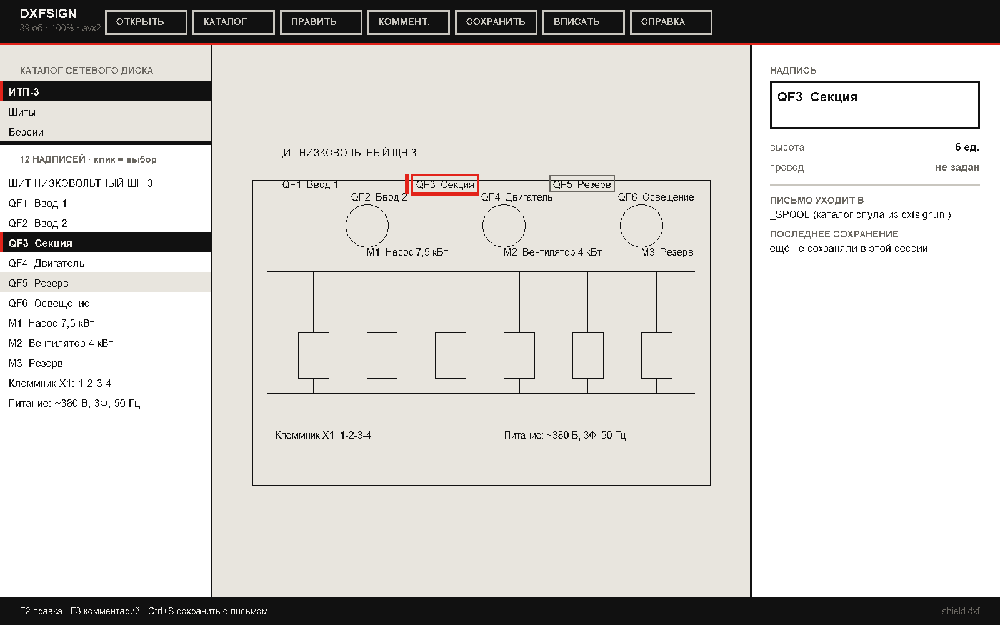
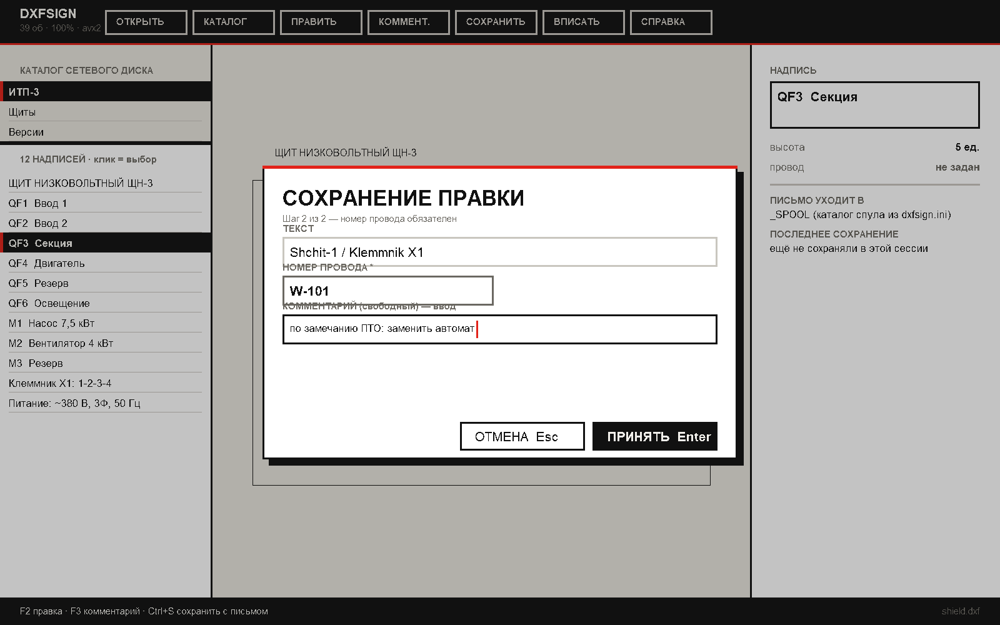

# dxfsign

**English** · [Русский](README.ru.md)

View and edit DXF drawings on a network drive where **every save is signed and mailed**: the working
file is overwritten, the previous version is rotated into `_VERSIONS`, a `.txt` change list is written
next to the drawing, and a ready-to-send `.eml` (both drawing states + HMAC signature) is dropped into
a spool directory.

A single executable, **zero dependencies**, no .NET, no VC++ redist.



Left — network-drive catalog and the list of drawing labels (click selects, double-click edits),
centre — canvas with hover highlight, right — label properties and the `.eml` spool path.
Top — toolbar: OPEN · CATALOG · EDIT · COMMENT · SAVE · FIT · HELP (`F1`).

## Download

**Version 1.0.3** — [latest release](../../releases/latest):

| File | Target |
|---|---|
| `dxfsign-1.0.3-win64.exe` | Windows 10 / 11 |
| `dxfsign-1.0.3-win7-x64.exe` | Windows 7 SP1 + KB2999226 (Universal C Runtime) |
| `SHA256SUMS.txt` | verify with `certutil -hashfile <file> SHA256` |

```bat
dxfsign.exe --version
```

## What it does

* reads ASCII DXF: `LINE`, `CIRCLE`, `ARC`, `LWPOLYLINE`, legacy `POLYLINE`+`VERTEX`, `SPLINE`,
  `SOLID`, `TEXT`/`ATTRIB`, `MTEXT` (formatting codes stripped), **`BLOCKS` + `INSERT`**
  (scale, rotation, layer-0 inheritance). Encoding: UTF-8 for DXF 2007+ (`AC1021`), CP1251 otherwise;
* writes back `LINE`, `CIRCLE`, `LWPOLYLINE`, `TEXT`, `MTEXT` (blocks are expanded to geometry on
  save — a named limitation);
* edits **label text** — the primary workflow: click, `F2`, type, `Enter`;
* after the edit it **requires a wire number** — the change is not applied without it. The number is
  stored in the drawing itself as XData (`1001 DXFSIGN`) and sent in the mail;
* accepts a **free-form comment** that goes into the proposed-changes list, the `.txt` and the `.eml`;
* save protocol: previous file → `_VERSIONS/<name>__<YYYYMMDD-HHMMSS>_<seq>.dxf`; working file
  replaced atomically; `.txt` next to it; `.eml` with three attachments (new `.dxf`, previous `.dxf`,
  `.txt`), HMAC-SHA256 over a canonical string, anchor row in `_VERSIONS/index.tsv`;
* network-drive catalog in an INI file with an in-app **catalog editor** (`F4`, system folder picker),
  file open via `Ctrl+O` or drag-and-drop;
* **Win32 window without a GUI framework**: toolbar, hover and selection highlight, wheel zoom
  **anchored under the cursor**, middle/right-button pan, list scrolling, `F1` help;
* **performance**: frames allocate nothing (asserted in tests), AVX2 projection with runtime dispatch
  and scalar baseline (×15 on 42 500 points), screen-space segment clipping, adaptive LOD — a
  150 000-segment drawing renders in **20 ms** instead of 109 ms.



## Quick start

```bat
:: window with the demo drawing
dxfsign.exe

:: open a specific file (or just drag it into the window)
dxfsign.exe "\\srv\project\switchboard.dxf"

:: what is inside a file — sections, entity types, blocks, inserts
dxfsign.exe report drawing.dxf

:: console workflow
dxfsign.exe inspect drawing.dxf
dxfsign.exe edit drawing.dxf --idx 1 --text "QF1 Incoming 1 (replaced)" --wire W-101 --comment "per review"
dxfsign.exe save drawing.dxf.edited.dxf --config dxfsign.ini --working drawing.dxf

:: measurements
dxfsign.exe frame-bench drawing.dxf --frames 20
dxfsign.exe bench drawing.dxf --iters 500
dxfsign.exe alloc drawing.dxf --frames 200
```

Mouse: click selects · double-click edits · wheel zooms under the cursor · middle/right button pans ·
wheel over the left panel scrolls. Keys: `F2` edit · `F3` comment · `Tab` next field · `Enter` apply ·
`Esc` cancel/exit · `Ctrl+O` open · `F4` catalog editor · `Ctrl+S` save with version and mail ·
`+`/`-`/`PgUp`/`PgDn` zoom · `F7` fit · `F1` help.

## Configuration

```ini
[app]
to_addr      = owner@example.invalid   ; where signed saves are mailed
from_addr    = dxfsign@localhost
spool_dir    = \\srv\\scan\\dxf\\_SPOOL   ; mail spool (network share — a delivery agent picks it up)
versions_dir = _VERSIONS               ; version folder next to the drawing
tz_offset    = 180                     ; minutes, MSK = 180
keep_versions= 0                       ; 0 = keep everything
key_env      = DXFSIGN_KEY             ; HMAC key from the environment (never from the file)
require_wire = true

[catalog]
SW-3  = \\srv\\projects\\sw-3\\dxf
Panels = \\srv\\projects\\panels
```

## Verified / not verified

`cargo test` — **57 tests**: SIMD against scalar, DXF round-trip, CP1251 and UTF-8 Cyrillic, MTEXT
chunks, blocks with rotation and scale, legacy polylines, splines, editing without a wire number,
comments, RFC 4231/4648/2047, **zero allocations per frame**, modal click geometry, end-to-end save
with version rotation and independent `.eml` parsing (Python `email`).

**Not verified:** real SMTP delivery (the mail is written to a spool by design), a real SMB share,
running on an actual Windows 7 machine, IME and clipboard in input fields, `HATCH`/`DIMENSION`/
`LEADER`/`XREF` rendering (counted and reported, not drawn), binary DXF.

## Windows 7

The win7 build is produced with rustc 1.77.2 — the last one whose standard library supports Windows 7.
Imports: `KERNEL32`, `USER32`, `GDI32`, `comdlg32`, `SHELL32`, `ole32`, `ntdll` + UCRT; no
`vcruntime`, no `api-ms-win-core-*` (Win10-only). UCRT requires **KB2999226** on Windows 7 SP1.
The win64 build is produced with current stable and **does** import `api-ms-win-core-synch-l1-2-0`,
so it is Windows 10/11 only.

```bat
rustup toolchain install 1.77.2
rustup target add x86_64-pc-windows-gnu --toolchain 1.77.2
cargo +1.77.2 build --release --target x86_64-pc-windows-gnu
```

## Architecture

| module | role |
|---|---|
| `doc.rs` | DOP model: SoA point/primitive arrays, indices instead of pointers, change log |
| `dxf.rs` | ASCII DXF read/write; blocks, inserts, legacy polylines, splines, text encodings |
| `edit.rs` | edit state machine: TEXT → WIRE NUMBER (mandatory) → COMMENT |
| `save.rs` | protocol: rotate version → atomic overwrite → `.txt` → `.eml` → chain anchor |
| `eml.rs` | RFC 5322 + MIME multipart + RFC 2047 + base64 |
| `ports.rs` | POP contracts: `FileSource`, `Signer`, `MailTransport`, `VersionStore` |
| `render.rs` | AVX2 projection, rasteriser, Brutalism + Swiss layout (as numbers) |
| `win32.rs` / `window.rs` / `dialogs.rs` | GDI typography, Win32 window, system dialogs |

Full technical solution (requirements, conflict table, stack rationale, O estimates, work plan):
[`docs/spec.md`](docs/spec.md) (Russian).

## License

MIT OR Apache-2.0.
