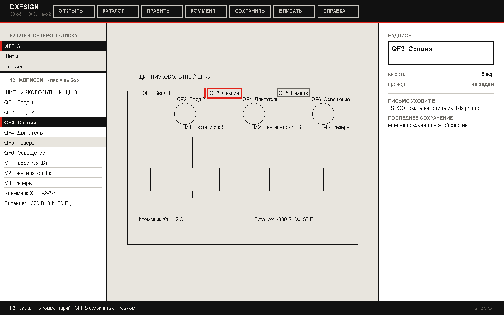
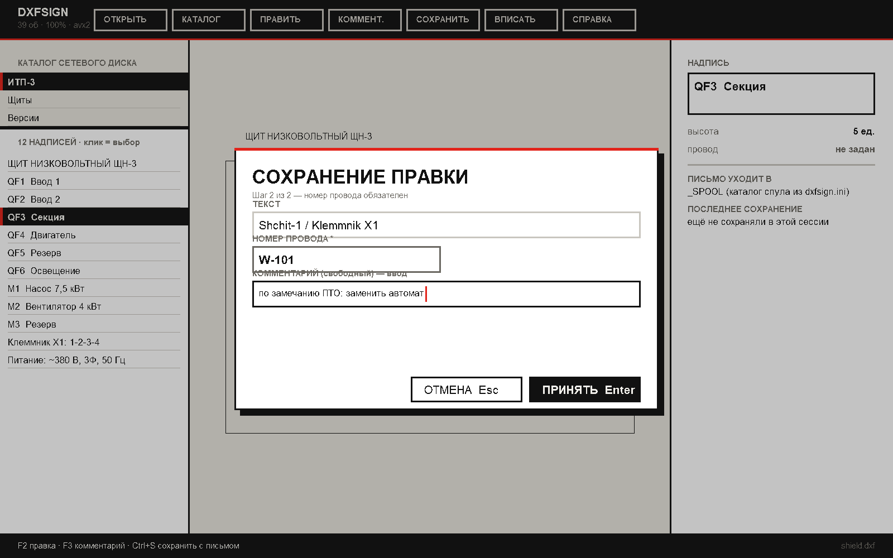

# dxfsign

[English](README.md) · **Русский**

Просмотр и правка DXF на сетевом диске, где **каждое сохранение подписано и отправлено письмом**:
рабочий файл перезаписывается, прежняя версия уезжает в `_VERSIONS`, рядом появляется `.txt`
с перечнем изменений, а в спул кладётся готовый `.eml` с обоими состояниями чертежа и HMAC-подписью.

Один исполняемый файл, **ноль зависимостей**, без .NET и VC++ redist.



Слева — каталог сетевого диска и список надписей чертежа (клик выбирает, двойной клик правит),
в центре — канва с подсветкой под курсором, справа — свойства надписи и путь спула `.eml`.
Сверху — тулбар: ОТКРЫТЬ · КАТАЛОГ · ПРАВИТЬ · КОММЕНТ. · СОХРАНИТЬ · ВПИСАТЬ · СПРАВКА (`F1`).

## Загрузка

**Версия 1.0.3** — [последний релиз](../../releases/latest):

| Файл | Для чего |
|---|---|
| `dxfsign-1.0.3-win64.exe` | Windows 10 / 11 |
| `dxfsign-1.0.3-win7-x64.exe` | Windows 7 SP1 + KB2999226 (Universal C Runtime) |
| `SHA256SUMS.txt` | проверка: `certutil -hashfile <файл> SHA256` |

```bat
dxfsign.exe --version
```

## Что умеет

* читает ASCII DXF: `LINE`, `CIRCLE`, `ARC`, `LWPOLYLINE`, старая `POLYLINE`+`VERTEX`, `SPLINE`,
  `SOLID`, `TEXT`/`ATTRIB`, `MTEXT` (с чисткой кодов), **`BLOCKS` + `INSERT`** (масштаб, поворот,
  наследование слоя «0»). Кодировка: UTF-8 для DXF 2007+ (`AC1021`), иначе CP1251;
* пишет обратно `LINE`, `CIRCLE`, `LWPOLYLINE`, `TEXT`, `MTEXT` (блоки при сохранении разворачиваются
  в геометрию — названное ограничение);
* правит **текст надписи** — главный сценарий: клик, `F2`, ввод, `Enter`;
* после правки текста **требует номер провода** — без него правка не применяется. Номер пишется в
  сам файл как XData (`1001 DXFSIGN`) и уходит в письмо;
* **комментарий без правки текста** (`--comment` / `F3`) номера провода **не требует** — замечание
  уходит в перечень изменений и в письмо;
* на шаге «номер провода» клик по полю **ТЕКСТ** возвращает к правке текста;
* принимает **свободный комментарий**, он идёт в перечень предлагаемых изменений, в `.txt` и `.eml`;
* протокол сохранения: прежний файл → `_VERSIONS/<имя>__<YYYYMMDD-HHMMSS>_<seq>.dxf`; рабочий файл
  перезаписывается атомарно; `.txt` рядом; `.eml` с тремя вложениями (новый `.dxf`, прежний `.dxf`,
  `.txt`), HMAC-SHA256 по канонической строке, якорь в `_VERSIONS/index.tsv`;
* каталог сетевого диска в INI и **редактор каталога** в окне (`F4`, системный выбор папки),
  открытие файла `Ctrl+O` или перетаскиванием;
* **папка спула** задаётся в окне по `F5` (пишется в ini) или в конфиге `spool_dir`; по умолчанию
  `_SPOOL` **рядом с чертежом**;
* **загрузка в фоне**: окно появляется сразу, видно этап/процент/число объектов, `Esc` отменяет —
  на чертеже с 820 000 объектов окно на экране через 0.3 с;
* **окно Win32 без фреймворков**: тулбар, наведение и подсветка выбора, зум колесом **под курсором**,
  панорама средней/правой кнопкой, прокрутка списка, справка `F1`;
* **производительность**: кадр без единой аллокации (проверяется тестом), AVX2-проекция с
  рантайм-детектом и скалярным базовым путём (×15 на 42 500 точках), отсечение отрезков по экрану,
  адаптивный LOD — чертёж на 150 000 отрезков рисуется **20 мс** вместо 109 мс.



## Быстрый старт

```bat
:: окно с демонстрационным чертежом
dxfsign.exe

:: открыть файл (или просто перетащить его в окно)
dxfsign.exe "\\srv\проект\щит.dxf"

:: что внутри файла — секции, типы сущностей, блоки, вставки
dxfsign.exe report чертёж.dxf

:: консольный сценарий
dxfsign.exe inspect чертёж.dxf
dxfsign.exe edit чертёж.dxf --idx 1 --text "QF1 Ввод 1 (заменён)" --wire W-101 --comment "по замечанию ПТО"
dxfsign.exe save чертёж.dxf.edited.dxf --config dxfsign.ini --working чертёж.dxf

:: замеры
dxfsign.exe frame-bench чертёж.dxf --frames 20
dxfsign.exe bench чертёж.dxf --iters 500
dxfsign.exe alloc чертёж.dxf --frames 200
```

Мышь: клик выбирает · двойной клик правит · колесо — зум под курсором · средняя/правая кнопка —
панорама · колесо над левой панелью прокручивает список. Клавиши: `F2` правка · `F3` комментарий ·
`Tab` следующее поле · `Enter` принять · `Esc` отмена/выход · `Ctrl+O` открыть · `F4` редактор
каталога · `Ctrl+S` сохранить с версией и письмом · `+`/`-`/`PgUp`/`PgDn` масштаб · `F7` вписать ·
`F1` справка.

## Конфигурация

```ini
[app]
to_addr      = owner@example.invalid   ; куда подписывать сохранения
from_addr    = dxfsign@localhost
spool_dir    = \\srv\scan\dxf\_SPOOL   ; спул писем (сетевой — доставку делает агент)
versions_dir = _VERSIONS               ; подпапка версий рядом с чертежом
tz_offset    = 180                     ; минуты, MSK = 180
keep_versions= 0                       ; 0 = хранить всё
key_env      = DXFSIGN_KEY             ; ключ HMAC из окружения (не из файла!)
require_wire = true

[catalog]
ЩН-3  = \\srv\projects\sw-3\dxf
Щиты  = \\srv\projects\panels
```

## Если что-то не работает

| Симптом | Причина и что делать |
|---|---|
| `отказано в доступе (os error 5)` при сохранении | Нет прав на папку или файл помечен «только чтение». Программа пишет точную причину; снимите атрибут (`attrib -R файл.dxf`) или сохраните в другую папку — при отказе правка уезжает в `%LOCALAPPDATA%\dxfsign\outbox`. |
| `файл открыт в другой программе (обычно AutoCAD)` | Чертёж открыт в AutoCAD. Пока файл занят, версия **не создаётся** — закройте чертёж и повторите, тогда появятся и версия, и письмо. |
| В `_VERSIONS` появилась версия, а чертёж не изменился | Это поведение 1.0.4 и раньше; в 1.0.5 занятость проверяется до ротации, такого больше не происходит. |
| Папка спула не появляется | Раньше относительный `spool_dir` считался от каталога запуска. Теперь — от папки чертежа; задать свою: `F5` в окне или `spool_dir` в ini. |
| Открывается долго / «не грузит» | Теперь чтение и разбор идут в фоне: окно появляется сразу, в центре видно этап, процент и число объектов, `Esc` отменяет. Если файл больше 1.5 ГБ или даёт больше 4 млн объектов, программа скажет об этом вместо зависания. |
| Ничего не рисуется, но объектов в статусе много | В файле только неподдержанные типы (`HATCH`, `DIMENSION`, `LEADER`, `XREF`) — они считаются и попадают в `report`, но не рисуются. |
| Русский текст «кракозябрами» | Файл старого формата определён как UTF-8 или наоборот. Проверьте `dxfsign.exe report файл.dxf` — там видно `$ACADVER`; пришлите файл, если кодировка нестандартная. |
| Это DWG | Программа не открывает DWG: в AutoCAD «Сохранить как» → DXF. |
| Хочу сохранить в другое место | Консоль: `dxfsign.exe save черновик.edited.dxf --working путь.dxf --fallback`. В окне при отказе прав резервное место показывается в строке состояния. |

## Что проверено, а что нет

`cargo test` — **57 тестов**: SIMD против скаляра, DXF round-trip, кириллица в CP1251 и UTF-8,
фрагменты MTEXT, блоки с поворотом и масштабом, старые полилинии, сплайны, правка без номера
провода, комментарии, RFC 4231/4648/2047, **кадр без аллокаций**, геометрия кликов модалки, сквозное
сохранение с ротацией версий и разбор `.eml` независимым парсером Python.

**Не проверено:** реальная отправка по SMTP (письмо кладётся в спул), настоящая SMB-шара, запуск на
живой Windows 7, IME и буфер обмена в полях ввода, отрисовка `HATCH`/`DIMENSION`/`LEADER`/`XREF`
(считаются и называются в `report`, но не рисуются), бинарный DXF.

## Windows 7

Win7-сборка делается rustc 1.77.2 — последним, у которого std поддерживает Windows 7. Импорты:
`KERNEL32`, `USER32`, `GDI32`, `comdlg32`, `SHELL32`, `ole32`, `ntdll` + UCRT; нет `vcruntime`, нет
`api-ms-win-core-*` (это API Win10). UCRT требует **KB2999226** на Windows 7 SP1. Win64-сборка
делается текущим stable и **содержит** `api-ms-win-core-synch-l1-2-0`, то есть только Windows 10/11.

```bat
rustup toolchain install 1.77.2
rustup target add x86_64-pc-windows-gnu --toolchain 1.77.2
cargo +1.77.2 build --release --target x86_64-pc-windows-gnu
```

## Устройство

| модуль | роль |
|---|---|
| `doc.rs` | DOP-модель: SoA-массивы точек и примитивов, индексы вместо указателей, журнал правок |
| `dxf.rs` | чтение/запись ASCII DXF; блоки, вставки, старые полилинии, сплайны, кодировки текста |
| `edit.rs` | автомат правки: ТЕКСТ → НОМЕР ПРОВОДА (обязателен) → КОММЕНТАРИЙ |
| `save.rs` | протокол: ротация версии → атомарная перезапись → `.txt` → `.eml` → якорь цепочки |
| `eml.rs` | RFC 5322 + MIME multipart + RFC 2047 + base64 |
| `ports.rs` | POP-контракты: `FileSource`, `Signer`, `MailTransport`, `VersionStore` |
| `render.rs` | AVX2-проекция, растеризатор, раскладка Brutalism + Swiss (числами) |
| `win32.rs` / `window.rs` / `dialogs.rs` | GDI-типографика, окно Win32, системные диалоги |

Полное техническое решение (требования, таблица противоречий, обоснование стека, оценки O, план
работ): [`docs/spec.md`](docs/spec.md).

## Лицензия

MIT OR Apache-2.0.
